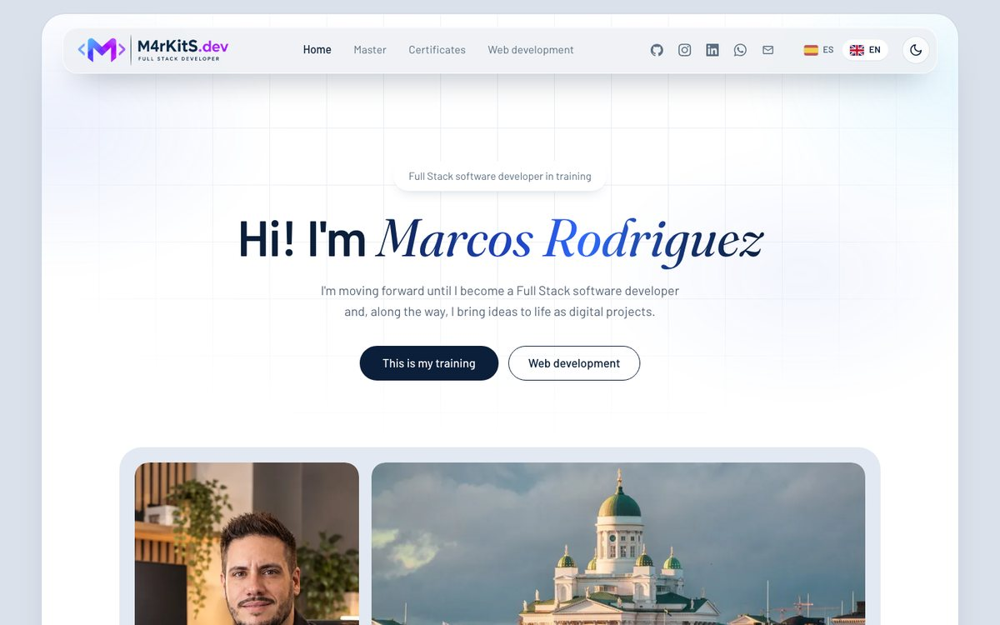

# M4rKitS.dev

> Personal portfolio and freelance web development site, in Spanish and English.



**Live site:** [m4rkits.dev](https://m4rkits.dev/) · [English](https://m4rkits.dev/en/)

## About

This is the source of my personal site. It has two parts:

- **Portfolio** (`/`): who I am, what I have learned in the Full Stack master at Conquer Blocks, my certificates and where I am heading.
- **Web development** (`/desarrollo-web/`): the website service I offer to small businesses, project examples and a contact form.

Everything is available in Spanish and in English, each with its own URL. No framework and no dependencies to install: plain HTML, CSS and JavaScript, served as static files from Cloudflare Pages.

## Features

- **Bilingual with real URLs**: Spanish at `/`, English at `/en/`. Each page declares its `hreflang` alternates and a canonical address, and the sitemap lists both versions.
- **Light and dark mode**, remembered in the browser.
- **Privacy by design**: no advertising or tracking cookies, fonts served from the site itself, visit statistics with Cloudflare Web Analytics (cookieless), and external content (a project preview window) only loads when the visitor asks for it.
- **Certificate viewer**: each certificate with an image opens in a window styled like the project previews, with the technology logo in the title bar. The images (WebP) are only downloaded when one is opened.
- **Legal pages** in both languages: legal notice, privacy policy and cookie policy.
- **Contact form** with [EmailJS](https://www.emailjs.com/): a notification for me, an automatic reply for the visitor and a thank-you page.
- **Accessible**: keyboard navigation, visible focus, labelled controls, reduced-motion support. Local Lighthouse audits give 100 for accessibility and for SEO.
- **Scroll animations** with [GSAP](https://gsap.com/) and ScrollTrigger, self-hosted and loaded after the page: staggered reveals, a progress bar and a marquee that reacts to scroll speed. They respect the reduced-motion preference and never hide content if JavaScript fails.
- **Light on the wire**: WebP images in several sizes, one shared stylesheet with long cache, no third-party requests apart from Cloudflare's own analytics (GSAP is served from this site).

## Tech stack

| Layer | Technology |
| --- | --- |
| Structure | HTML5 |
| Styling | CSS3 (custom properties, Grid, Flexbox) |
| Behavior | Vanilla JavaScript |
| Motion | [GSAP](https://gsap.com/) 3 + ScrollTrigger (self-hosted in `vendor/`) |
| Forms | [EmailJS](https://www.emailjs.com/) |
| Hosting | [Cloudflare Pages](https://pages.cloudflare.com/) |
| Analytics | Cloudflare Web Analytics |

## Project structure

```text
.
├── index.html                 # Portfolio (Spanish)
├── desarrollo-web/            # Web development page (Spanish)
├── aviso-legal/ privacidad/ cookies/ gracias/
├── en/                        # English version of every page
├── css/                       # Shared stylesheet (content-hashed file name)
├── img/ fonts/ vendor/        # Images, self-hosted fonts, EmailJS SDK
├── sitemap.xml  robots.txt  llms.txt
└── _headers  _redirects       # Cloudflare Pages configuration
```

## How it is built

The HTML pages are generated from a small local script and committed as static files, so the site itself needs no build step to deploy.

## Development workflow

I designed and built this site with the help of Claude (Anthropic's AI assistant, through Claude Code). The design decisions are mine, and I review and test every change. I am studying the Full Stack master at Conquer Blocks to understand and maintain the code behind it.

## Local development

No build step is needed to view the site. Clone the repo and serve it with any static file server:

```bash
git clone https://github.com/M4rKitS/M4rKitS.dev.git
cd M4rKitS.dev
python3 -m http.server 8080
```

Then open `http://localhost:8080`.

## Contact

- **Web:** [m4rkits.dev](https://m4rkits.dev/)
- **Email:** contact@m4rkits.dev
- **LinkedIn:** [linkedin.com/in/mrodriguezhdz](https://linkedin.com/in/mrodriguezhdz)
- **GitHub:** [@M4rKitS](https://github.com/M4rKitS)
